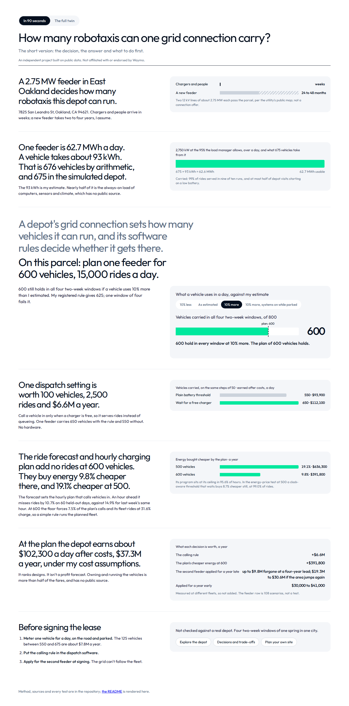
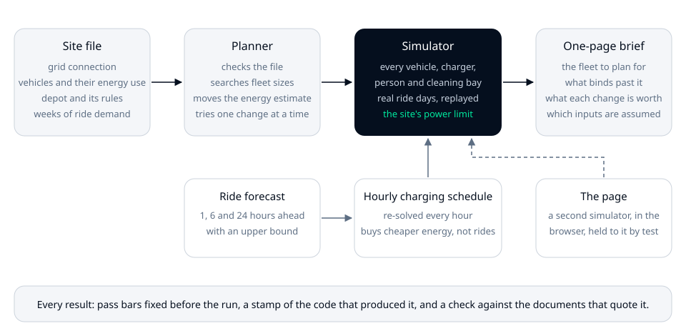

# depot-twin

A depot's grid connection sets how many vehicles it can run, and its software rules decide whether it gets there. On this parcel I'd plan one feeder for 600 vehicles.

depot-twin is a simulated robotaxi depot on a real East Oakland industrial parcel, with 2.75 MW of published grid headroom on one feeder (the utility's local 12 kV line). It comes with a planner that works on any site and the tests behind every number.

It's an exploratory study I built alone on public data. It isn't an operating tool, and it's independent: not affiliated with or endorsed by Waymo.

**See it:** [the short version](https://yannickyamo.github.io/depot-twin/) · [the full twin](https://yannickyamo.github.io/depot-twin/?view=full) · [the story](docs/STORY.md) · [the product brief](docs/PRODUCT.md)



## The pain point

A robotaxi fleet grows only as fast as its depots can turn vehicles around. The fleet a site will carry gets decided once, at lease signing, when the grid connection is applied for, years before a vehicle shows up. Chargers and people arrive in weeks. A new feeder takes two to four years, which is my assumption and not a utility quote.

From outside, that number looks like it comes from a spreadsheet of energy arithmetic. The spreadsheet gets the energy right. It can't show that one calling rule is worth a hundred vehicles, what binds past the number, or what's left when the energy estimate is wrong. Guess low and the site is short of vehicles for years. Guess high and vehicles queue for chargers the grid can't feed.

## The three decisions

What I'd do at lease signing, in this order.

1. **Plan one feeder for 600 vehicles. The grid sets the ceiling.** One feeder [carries](docs/METHOD.md#glossary) 675 vehicles if my energy estimate is right. Carries means it serves 99% of rides in nine simulated runs out of ten, with no more than half of its depot visits starting on a low battery. I plan that feeder for 600 vehicles, 15,000 rides a day, because the energy a vehicle uses is my estimate, and a vehicle that uses a tenth more means about a tenth fewer vehicles. 600 still holds with 10% more energy on the road.

2. **Put the calling rule in the dispatch software first. Rules decide whether you reach the ceiling.** Call a vehicle in only when a charger is free. Tested in steps of 50, that rule carries 650 vehicles where a plain battery threshold carries 550 vehicles. It's a setting in the dispatch software, no hardware. A second rule, feeding vehicles in the order they plugged in, only matters once a fleet has outgrown its feeder.

3. **Meter one vehicle before signing. It's the cheapest next step.** If a vehicle uses a tenth more energy than I estimated and keeps its systems on while parked, the feeder carries 550 vehicles and not 675. Metering one real vehicle through a whole day, on the road and parked, settles that gap of 125 vehicles.

## Architecture, and what each choice costs



A simulator follows every vehicle, charger, person and cleaning bay through real replayed ride days. A ride forecast and an hourly charging schedule sit on top of it. A planner (`depot-twin plan`) takes any site file and writes a one-page brief.

Every choice bought something and gave something up. Both are written down.

| Choice | What it costs | Why I took it |
| --- | --- | --- |
| A simulated day, not arithmetic | A plan takes about an hour of computing | Only a simulated day shows one calling rule is worth a hundred vehicles |
| Detailed depot, aggregate road | No street-level routing | The question is the depot |
| Simulator stays in the loop; the fast model only shortlists | Every candidate design costs a simulated run | The fast model was wrong on exactly the designs a search picks |
| A simple rule runs the planned fleet | The hourly charging schedule isn't the headline | At the planned fleet, the schedule serves the same rides |
| The hourly charging schedule is kept for energy | Extra machinery to maintain | It buys cheaper energy |
| My own trained forecast is the reference | Not the most accurate model | Reproducible from public data, no outside dependency |
| Planner is a command over a text file | No hosted app, no accounts, no saved scenarios | Version control already keeps, compares and shares text |
| Browser page runs its own simulator | Two simulators to keep in step, held together by test | Anyone can change a design and watch it without a server |
| Results stamped with the code that produced them | Simulator changes mark results stale | A figure is true of the code that ran, not the code today |

## How the numbers are held

I fixed the pass conditions, the bars, for each of 30 tests before running it. 82 of 123 bars passed, about two thirds, and the misses are published. The headline figures in this README, the story and the findings are checked against their result files on every change.

## Go deeper

- [The story](docs/STORY.md): what I believed, what I got wrong, what I decided.
- [The product brief](docs/PRODUCT.md): the user, the decision, what I'm not building.
- [Plan your own site](docs/SITES.md): the site file and what each input moves.
- Reference: [findings in full](docs/BRIEF.md) · [method and glossary](docs/METHOD.md) · [forecasts](docs/ML.md) · [every test](EVALS.md) · [data](docs/DATA.md) · [decision log](docs/DECISIONS.md) · [code map](docs/CODE.md) · [scoreboard](docs/SCOREBOARD.md)

## Run it

```bash
git clone https://github.com/yannickYamo/depot-twin && cd depot-twin
pip install -e ".[data,ml,opt,dev]"
depot-twin reproduce         # six of the published runs, from inputs kept in the repository
depot-twin plan sites/east_oakland.toml   # plan a site from its file (about an hour)
cd web && npm ci && npm run dev   # the page, locally
```

```bash
make check                   # lint, types and the full test suite, as CI runs them
depot-twin eval e23          # run one test again (E23, the capacity test)
depot-twin stale             # list any result the code has moved away from
depot-twin facts             # check this README's figures against the result files
```

On macOS, XGBoost needs OpenMP: `brew install libomp`. Exact package versions are in [requirements-frozen.txt](requirements-frozen.txt). License: source-available, see [LICENSE](LICENSE).
