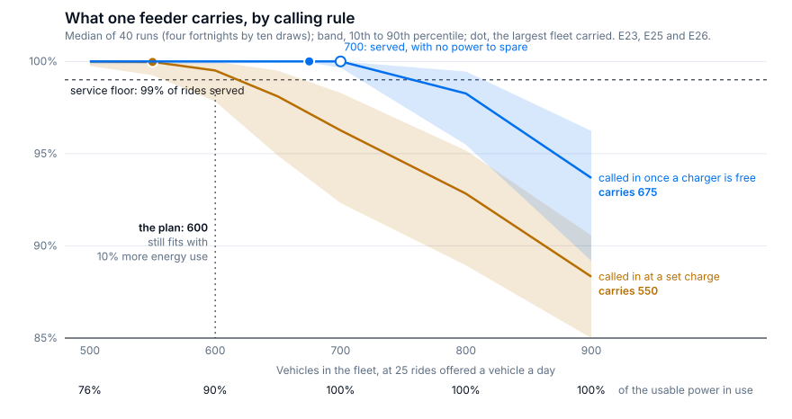
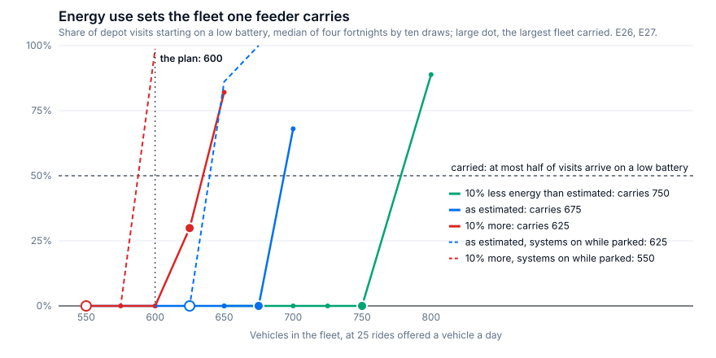
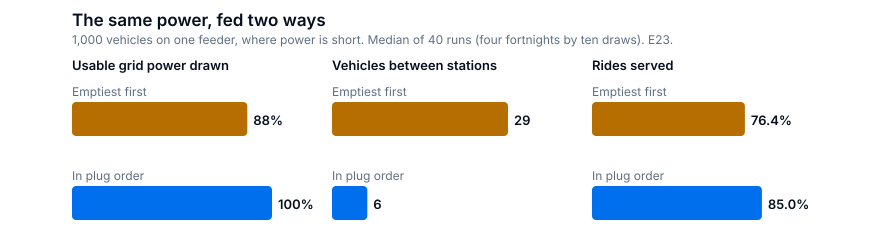
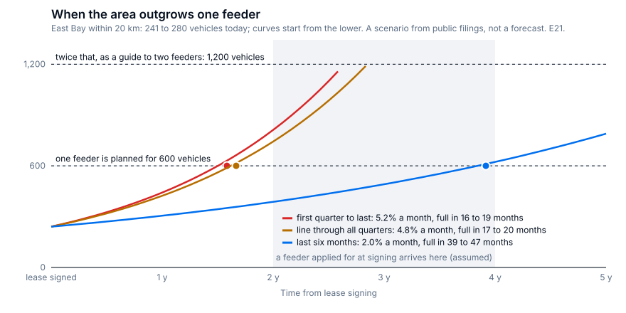
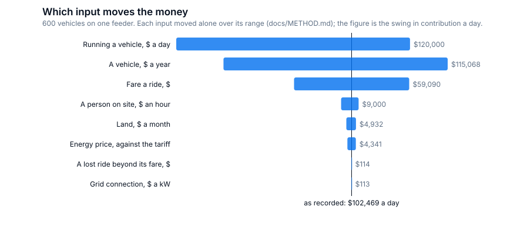

# Findings in full: what one depot's grid connection is worth

[Back to the README](../README.md)

*The findings in full: every headline figure with its range and conditions. For a reader who wants every figure behind the README. The one thing to take: plan one feeder for 600 vehicles, and put the calling rule in the dispatch software first.*

## The decision

The README leads with three things to do: plan for 600, put the calling rule in first, and meter one vehicle. This document adds the power rule and the timing of the second feeder.

The site lead who signs the lease and files the grid application decides the first and third of the calls below; fleet operations owns the second.

1. **Plan one feeder for 600 vehicles, 15,000 rides a day, at a 99% service floor.** At the energy use I estimate the feeder carries 675 vehicles. 600 is the fleet that is still carried in every fortnight if the vehicles use 10% more energy on the road, or if their systems stay on while they're parked in the depot. With both it isn't, and the fleet that is comes to 550 vehicles. 700 vehicles are the most tested that still serve 99%, with the feeder at its limit all week and 61% of depot visits starting on a low battery.
2. **Put two rules in software before buying anything.** Call a vehicle in only when a charger is free for it: on the same steps of 50 vehicles that carries 650 vehicles where the plain rule carries 550 vehicles. And feed in order of arrival when power is short: 8.5 points of rides at 1,000 vehicles on one feeder under a plain threshold (8.1 to 9.1), and nothing at 500 and 600 where power is to spare.
3. **Apply for the second feeder at lease signing.** The 20 km area would keep 241 to 280 vehicles busy today on an unadjusted reading. At the growth the filings show since the service area last changed it outgrows the planned fleet in 39 to 47 months; two faster readings that span the enlargement of that area give 16 to 20 months.

The capacity and rule figures rest on four fortnights of real San Francisco demand replayed with ten draws each, 25 rides offered a vehicle a day, and the visit pattern the public filings count, about three short visits a day; where a figure comes from another setting, the text says so. The ten draws of a fortnight barely differ, so the forty runs are worth about four, and every range is a range across four fortnights of one spring.

Two kinds of figure are in this brief, and they aren't the same strength. The capacity, rule and forecast figures come from registered tests whose bars were fixed before their runs: 30 tests, 82 of 123 bars passed, the misses in the record ([EVALS.md](../EVALS.md); index [docs/SCOREBOARD.md](SCOREBOARD.md)). The dollar figures, the months to a second feeder and the side studies (staffing, session length) have no bars, and each is marked where it appears. This is an independent project on public data, not affiliated with or endorsed by Waymo.

## The problem

A robotaxi earns only while it's on the road. Every vehicle comes back to a depot to charge and be cleaned, so the depot's capacity to turn vehicles around sets the ceiling on the service.

Chargers, people and cleaning bays get added in weeks. A grid connection takes years. **The parcel and its feeder are the lease-time decision, and they're made with the least information.**

As far as I can tell from outside, how many vehicles a site will carry gets answered today by hand arithmetic and by finding out in production. Arithmetic gives you the energy limit and misses everything that bites before it: queues at the chargers, the evening when half the fleet comes back empty together, power shared badly.

## Who it is for

- **Depot planning** chooses and sizes sites. They need what a parcel's grid connection is worth in rides before signing.
- **Fleet operations** runs the site day to day. They need rules for calling vehicles in and sharing power that protect the peak.
- **Market expansion** sets the fleet ramp for a city. They need the date the current site runs out.

## What success looks like

**Rides served as a share of rides asked for.** A rider waits up to ten minutes and is then lost, so the cost of a depot that can't keep up is a ride nobody serves.

Under that: vehicles on the road in the busiest hours; time in the depot a visit; energy delivered a day against what the site can deliver, which is the hard ceiling; and vehicles stranded, which must be zero.

Beside it, once service holds: price paid a kWh, and contribution a vehicle-day.

## Evidence 1: what one feeder carries

| Fleet | Threshold | Threshold that waits for a free charger | Hourly plan | Power in use |
|---|---|---|---|---|
| 500 | 100.0% (99.9%), none | 100.0% (100.0%), none | 100.0% (100.0%), 19.7% | 76% |
| 600 | 99.8% (98.7%), none | 100.0% (99.9%), none | 100.0% (99.5%), 51.7% | 90% |
| 700 | 97.0% (93.4%), none | 100.0% (99.8%), 60.8% | 97.0% (94.2%), 92.3% | 100% |
| 800 | 93.7% (90.0%), none | 98.6% (95.9%), all | 93.3% (89.5%), all | 100% |
| 900 | 89.3% (84.8%), none | 94.1% (89.7%), all | 88.9% (84.3%), all | 100% |
| **Carried** | **500** | **600** | **500** | |

Rides served on one feeder, median of forty runs with the 10th percentile in brackets (which is the weakest fortnight), then the share of depot visits that start on a low battery; the last column is the share of the feeder's usable power the waiting rule draws.

**A fleet counts as [carried](METHOD.md#glossary) when nine runs in ten serve 99% and no more than half its depot visits start on a low battery, 12% or under.** Past that, vehicles are coming in because they're nearly empty and not because the calling rule sent them, and that's a depot with no margin. With ten near-identical draws a fortnight, nine runs in ten usually means every fortnight serves 99%. The low-battery half of the rule is read on the median of the forty and can pass with one fortnight over the line, which is why the second table below has a column for every fortnight.

Look at 700 under the waiting rule: every ride served in the median run, feeder at its limit in every step, 61% of visits starting low. Two of the four fortnights carry it and two don't, with the same rides offered. An edge, not a plan.

The table moves a hundred vehicles at a time, so the fleets in between were run on the same forty fortnight-and-draw pairs. 650 and 675 vehicles are both carried: 675 serve at least 99.95% of rides in every run with the feeder at 99% of its usable power. In three fortnights no visit starts low; in the fourth, 37% do.

**That 99% is the finding, and it's why the plan is lower.** What fills the feeder is the energy a vehicle takes from it in a day, and two parts of that have no public source: what the vehicle uses on the road (I estimate 0.27 to 0.30 kWh a mile plus a 1.8 to 2.0 kW always-on load, about 0.53 kWh a mile all in), and whether that always-on load keeps running while the vehicle is parked in the depot (the model assumes not). So I ran the test with each moved against me:

| A vehicle's energy use | Largest fleet carried | Carried in every fortnight | Feeder's energy a vehicle a day |
|---|---|---|---|
| 10% less on the road | 750 vehicles | 750 | 83 kWh |
| As estimated | 675 | 675 | 92 kWh |
| 10% more on the road | 625 vehicles | 600 | 100 kWh |
| As estimated, systems on while parked | 625 | 625 | 99 kWh |
| Both | 575 vehicles | 550 | 109 kWh |

The feeder gives 62.7 MWh a day, and each fleet in the second column is the largest that fits under it. That's close to arithmetic, and the arithmetic is the point: once the calling and power rules are right, nothing else in this depot stands between the feeder and the fleet. The two moved inputs below, ride length and rider patience, are the exceptions, where vehicles run short first.

So the fleet to plan on is the one that survives an estimate being wrong. 600 vehicles are carried in every fortnight with 10% more energy on the road (feeder at 98%), and in every fortnight with the parked load counted (feeder at 94%). With both together 600 serves 99% in barely half its runs, and the fleet that holds is 550. The rule I registered before the energy test, the largest fleet carried with 10% more over all forty runs together, gives 625; in one fortnight of four, 52% of that fleet's visits start low against a line at 50%, so the verdict on 625 turns on where that line is drawn, and I plan on 600. Parking a vehicle with its systems on costs the feeder about 5 kWh a vehicle a day.

The calling rule is worth a hundred vehicles of capacity. On the same steps of 50, the plain threshold carries 550 and the waiting rule 650. At 600 the plain rule misses 99% in one fortnight of the four, in all ten draws; at the planned fleet the rule is the difference between holding the floor in every fortnight and not.

Each fortnight is replayed until the fleet has settled, then its last week is scored. A fleet near the edge takes more than a week to run down the charge it started with.

Rides a vehicle moves the fleet count more than the rides do. At 18 or 21.5 rides a vehicle a day, the feeder carries 700 (four fortnights by three draws for each moved input). At its limit, while still holding the 99% floor, it serves 17,200 to 18,000 rides a day whether the fleet is 700 at 25 rides, 800 at 21.5 or 1,000 at 18, because a vehicle on the road draws energy whether or not it carries anyone.

Two inputs change what binds. With 28-minute rides in place of 23, or riders who wait five minutes in place of ten, no fleet from 500 to 900 holds the floor with power to spare. The vehicles run short before the grid does.

## Evidence 2: the power rule

**When the site is short of power, feed plugged-in vehicles at full rate in the order they plugged in.**

Against the obvious rule, emptiest first: 85.0% of rides served against 76.4% at 1,000 vehicles on one feeder, and a point or more in all forty pairs of runs.

Emptiest first fails because it evens out the charge of everything plugged in, so vehicles finish together. It draws 88% of the usable power where feeding in order draws all of it, and leaves 29 vehicles standing between stations against 6.

Where power isn't short, it buys no rides. At 500 and 600 vehicles the two rules serve the same. Emptiest first is still the worse habit there: at 600 it leaves 46% of visits starting on a low battery where feeding in order leaves none.

The gain depends on staffing. In a side study with no bars (long charging visits, one fortnight, ten draws) it closes from 6.4 points to 3.0 as people are added, and no further. A depot with automated connectors would see the low end.

Repeated on another city's days, the textbook rule of least energy left first ties with in-order feeding. So the rule to state is this: feed at full rate in any order that finishes vehicles one after another.

## Evidence 3: when the second feeder is needed

Everything in this section is a scenario built on public filings. None of it is a test.

The filings' served tracts over census population give 0.17 trips a resident a month over the last four quarters, and 0.20 in the latest. The East Bay within 20 km of the parcel holds 1.08 million residents and 6,000 to 7,000 rides a day at that rate, which is 241 to 280 vehicles. It's an unadjusted reading: statewide trips a resident, much of it Los Angeles and visitors to San Francisco, applied to Oakland with no correction for either.

Growth is the weak link. E21 read it three ways: 5.2% a month from first quarter to last, 4.8% on a fitted line, 2.0% over the last six months. The first two span the quarter in which the service area in the filings was enlarged, from 1,496 tracts to 1,796, and trips a day rose 56% across it. Since then, over nine months, trips have grown 2.0% a month. That's the rate to plan on, and it puts the area past the 600 planned vehicles in 39 to 47 months, counted from the first half of 2026 where the filings end. The two faster readings give 16 to 20 months, and they describe what another enlargement like that one would do.

A feeder takes two to four years from application (assumed) and costs $550,000 for 2.75 MW. A vehicle the first feeder can't carry earns nothing; on a second feeder it would add $183 a day at the base costs, which is its fares less everything that grows with the fleet. The land and the first connection are paid either way, so they're left out. The table crosses both readings of today, the three of growth, lead times of two, three and four years, two discount rates and three levels of vehicle cost: 108 scenarios.

| Applying a year after signing | Contribution left unearned |
|---|---|
| Growth of 2.0% a month, feeder takes two years, base vehicle costs | nothing; the capital is paid a year later |
| Growth of 2.0% a month, feeder takes four years, base vehicle costs | $4 to $10 million |
| A jump like the last enlargement, any lead, base vehicle costs | $19 to $31 million |
| Across the range of vehicle costs | nothing to $53 million |

The top of the third row is a cap and not a measurement: once demand is past two feeders' worth for the whole year, the loss is 600 vehicles' contribution for twelve months, discounted to signing ($40 million before discounting). And if a vehicle costs what the dear end of my range says, it earns nothing and there's nothing to lose by waiting.

**The asymmetry is the decision.** Applying a year early costs $30,000 to $41,000 in capital paid sooner, and the $550,000 connection if the growth never comes. Applying late costs nothing only if growth stays slow and the utility is quick.

## Evidence 4: what the hourly plan and the forecast are for

A plan that redraws the next 24 hours every hour from ride forecasts carries no more vehicles than a threshold does: 500. Fed a forecast cut to a third, it serves the same rides, measured under long charging visits.

What it buys is cheaper energy: 6.7% less a kWh at 500 vehicles (5.8% to 7.7% across forty pairs), with rides level. It's steering charging around the tariff's 4 pm to 9 pm peak; under long visits, a plan whose optimizer can't see prices pays the same. Size that against energy being 3.7% of fare revenue. Worth having, not what makes a depot work.

The forecast buys a tighter bound, not rides. Converted to vehicles, the margin the bound carries is 50 to 99 with the model against 64 to 127 with last week's curve, across four conditions on one fortnight under long visits. It isn't vehicles a plan held back, and no run served more rides for it.

One hour ahead over 26 weeks of Chicago ride-hail, the forecast shows 5.9% error against 8.6% for the same hour last week. Last week's hour is one noisy count at a depot's scale, so I also built the forecast a planner with no model would use, the average of the last eight weeks scaled by the day so far: 6.2%. Against that, the model trained here is ahead by 0.3 points in Chicago, and by about 2 points in New York. A pretrained model used as it comes (Chronos-2) reaches 5.4%, ahead of mine by 0.45 points on a 90% range clear of zero, and ahead on all three series tested. In New York most of its lead comes from four disrupted weeks. Chicago is the firm result, on one city, 26 weeks and one thinning of the rides. It's the better model one hour ahead; the one trained here stays as the reference that can be rebuilt from public data. Detail in [docs/ML.md](ML.md).

## Evidence 5: the money

| Fleet on one feeder | Depot's contribution before the fleet's cost | Fleet's cost | Lost-ride charge | Contribution | Range across runs |
|---|---|---|---|---|---|
| 500 | $216,800 | $132,200 | $0 | $84,600 | $84,300 to $84,800 |
| 600 | $261,100 | $158,600 | $0 | $102,500 | $102,300 to $102,600 |
| 650 | $284,000 | $171,800 | $0 | $112,100 | $111,800 to $112,200 |
| 700 | $307,000 | $185,100 | $200 | $121,700 | $120,400 to $122,200 |
| 800 | $346,000 | $211,500 | $7,400 | $127,100 | $109,300 to $138,500 |
| 900 | $372,300 | $237,900 | $28,500 | $105,900 | $70,500 to $131,800 |

Dollars a day as the mean of the same forty runs, under the rule that waits for a free charger.

The fleet's cost is two assumed figures multiplied by the fleet, $60,000 a vehicle a year and $100 a day to run it, and neither has a public source. Together they're 54% of fare revenue. Moved across their ranges ($30,000 to $100,000; $50 to $250), each swings the day's contribution at 600 vehicles by $115,000 to $120,000, which is more than every depot input together. **So the account ranks depot designs and doesn't state a profit.**

Contribution keeps rising past the carried fleet because every added vehicle is assumed to find its 25 rides. The account doesn't say the rides are there.

It also pulls past the service floor: 800 vehicles earn more than 700 while losing about 370 rides a day on average, 280 in the median run. That only holds while a lost ride is valued under $51 beyond its fare in the median run, and anywhere from $6 to $219 across the forty. That value is a guess. The service floor has to be set as policy, then sized to.

A ride pays the published average fare, $19.69, from a price survey of the Bay Area service ([DATA.md](DATA.md)). Busy pricing as modelled moves the price between hours and leaves the average there, so in this account scarcity doesn't pay by construction.

## Evidence 6: the planner, and further from the estimate

`depot-twin plan` takes a site file and answers the same questions for any site ([SITES.md](SITES.md)). On the East Oakland file it gives the study back: arithmetic puts the fleet at 663 vehicles, the feeder carries 675 vehicles, 600 vehicles with 10% more energy on the road and 625 with the parked load, so the plan is 600. Take away either operating rule and the carried fleet drops to 575 vehicles or below. A quarter more chargers adds 25 vehicles. A quarter more people adds none.

The same depot run against other demand carries 675 in all of it: the study's San Francisco weeks counted by the hour, and Chicago and New York ride-hail with one fortnight from each season. Twelve fortnights across three cities. Once every week is scaled to the same rides per vehicle, the shape of the week is not what limits this feeder. Energy is. A busier vehicle is a different limit. At 27.5 rides per vehicle per day the feeder carries 650 vehicles. At 30 rides, no fleet I ran is carried: vehicles run short at the busiest hours while the feeder still has power to give. Not tested: a winter in which vehicles use more.

Pushed further than 10%, the fleet keeps following the fleet carried at the estimate, scaled by energy: 575 vehicles at 20% more energy on the road (a registered bar) and 525 vehicles at 30% more (run, with no bar).

## Assumptions that matter most

The full table is in [docs/METHOD.md](METHOD.md). Five matter here.

- **25 rides a vehicle a day** (assumed): sets the fleet count more than the rides do. Every fortnight is scaled to it, so no replayed week is busier than the level assumed. Moved on its own, 27.5 rides carries 650 vehicles, and at 30 no fleet from 525 to 600 is carried: vehicles run short at the busiest hours before the feeder does (E28).
- **Demand shaped like San Francisco's week** (measured, in another city, over four fortnights from March to May 2024).
- **Energy a vehicle takes in a day** (assumed, no public source): 0.27 to 0.30 kWh a mile plus an always-on load on the road, and nothing while parked. The carried fleet moves one for one with the total: 750, 675 and 625 at 10% less, the estimate and 10% more on the road, and 625 with the parked load counted.
- **2.75 MW a feeder** (published map reading, not a connection offer). A second service on the same parcel is assumed to be available.
- **Vehicle cost and running cost** (assumed, no public source): these decide the size of every dollar figure.

## Trade-offs taken

Every choice here bought something and gave something up, so I've written both down.

| Choice | What it costs | Why I took it |
| --- | --- | --- |
| A simulated day, not arithmetic | A plan takes about an hour of computing | Only a simulated day shows one dispatch rule is worth a hundred vehicles |
| Detailed depot, aggregate road | No street-level routing | The question is the depot |
| Simulator stays in the loop; the fast model only shortlists | Every candidate design costs a simulated run | The fast model was wrong on exactly the designs a search picks |
| A simple rule runs the planned fleet | The elaborate controller isn't the headline | At the planned fleet, the hourly plan serves the same rides |
| Hourly linear program kept for energy | Extra machinery to maintain | It buys cheaper energy |
| My own trained forecast is the reference | Not the most accurate model | Reproducible from public data, no outside dependency |
| Planner is a command over a text file | No hosted app, no accounts, no saved scenarios | Version control already keeps, compares and shares text |
| Browser page runs its own simulator | Two simulators to keep in step, held together by test | Anyone can change a design and watch it without a server |
| Results stamped with the code that produced them | Simulator changes mark results stale | A figure is true of the code that ran, not the code today |

- **A range beside every number.** Forty runs a figure showed where the spread comes from: the fortnight, not the draw. Four fortnights is the real sample, and more weeks would be worth more than more draws.

## What would prove this wrong

- A vehicle's measured day more than about 11% above the 94 kWh the feeder gives it at 600: the feeder has 104.5 kWh a vehicle to give, the plan is shown to hold at 9% above, and past that the fleet falls in proportion.
- A busy season. All four fortnights are spring weeks at one level of demand.
- A demand peak in the East Bay much sharper than San Francisco's.
- Utility headroom that isn't what the map says once an application is filed.
- A fleet management system that already shares power in order: then the largest gain here is one the operator already has.

## Who decides what

The twin informs. The site lead sets the service floor, signs the lease and files the grid application, and answers for all three; fleet operations owns the two rules.

## Rollout

1. **Measure the energy.** Before signing, meter what one vehicle really takes in a day at a live depot, on the road and parked. It settles the 125 vehicles between 550 and 675 for the price of a meter.
2. **Shadow.** Run the twin beside one live depot for two weeks and compare predicted and actual queue, energy drawn from the feeder and depot visits a vehicle a day.
3. **The two rules.** Trial calling in only against a free charger, and in-order feeding, on part of one depot with the current rules as control. Cheapest to test.
4. **Planning.** Size the next site, and date its second feeder, before the lease.
5. **The plan.** Shadow first, never acted on; then let it steer charging around the price peak behind a guard that hands control back to the simple rule if its forecasts break.
